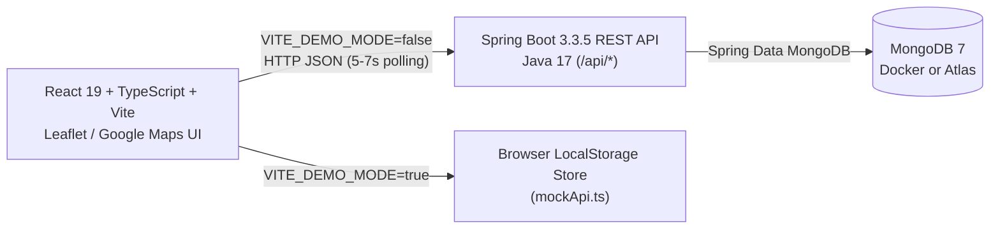

# MediRoute

**Emergency Ambulance-to-Hospital Dispatch, Bed Matching & Live Routing Coordination Platform**

MediRoute coordinates 108-style emergency ambulance intake, capability-based hospital matching, atomic bed reservations, and live route tracking across two explicit data modes: a **browser-local synthetic demo mode** (`localStorage`) and a **Spring Boot + MongoDB REST API mode**.

> **Operational Notice:** MediRoute is an engineering prototype and decision-support interface. It does **not** connect to Tamil Nadu 108 / EMRI dispatch feeds or live hospital HIS systems, and the role selector is not authentication. Do not deploy with real patient incidents without provider adapters, authentication/RBAC, audit logging, and clinical/operational approval.

---

## Table of Contents

- [Key Capabilities](#key-capabilities)
- [Architecture & Tech Stack](#architecture--tech-stack)
- [Repository Structure](#repository-structure)
- [Prerequisites](#prerequisites)
- [Environment Configuration](#environment-configuration)
- [Quick Start](#quick-start)
- [Application Views & Matching Behavior](#application-views--matching-behavior)
- [REST API Reference](#rest-api-reference)
- [Testing & Verification](#testing--verification)
- [Production Readiness & Integration Notes](#production-readiness--integration-notes)

---

## Key Capabilities

- **Streamlined 2-Step Case Intake (`/ambulance/new-case`)**: Dispatchers provide only **Pickup Location** (browser GPS **"Use Current Location"**, regional landmark quick-select, or address input) and a **Patient Condition Category** across 11 plain-language categories (`CARDIAC`, `TRAUMA`, `RESPIRATORY`, `STROKE`, `BLEEDING`, `UNCONSCIOUS`, `MATERNITY`, `PEDIATRIC`, `BURNS`, `POISONING`, `GENERAL_EMERGENCY`) that map automatically to required hospital services and equipment.
- **Guaranteed Hospital Matching & Nearest-First Routing**: Evaluates hospital open status, intake readiness, available emergency beds, required services/equipment, and freshness, ordering eligible candidates **nearest first** by Haversine distance. When strict capability filters yield zero matches, a 4-tier fallback automatically surfaces the closest open emergency hospitals so every active case shows at least one hospital destination.
- **Interactive Maps & Driver Destination Selection**: Both the Dashboard Map (`/ambulance`) and Live Tracking (`/ambulance/map`) remain on clean standby when no new case is active and display origin markers, destination pins, dashed routes, and directional bearings once a live case is active. Drivers can switch to alternative recommended hospitals directly from Case Detail (`/ambulance/cases/:id`) or the Live Tracking banner and map popups.
- **Hospital Capacity Desk & Atomic Bed Reservation (`/hospital`)**: Hospital staff can toggle operational status (`OPEN` / `CLOSED`), pause intake, update bed counts and equipment, and accept or reject incoming requests using atomic MongoDB `findAndModify` locks to prevent double-booking.
- **Strict Separation Between Demo & Live Modes**: Controlled explicitly via `VITE_DEMO_MODE`; API mode surfaces errors cleanly instead of silently falling back to synthetic fixtures.

---

## Architecture & Tech Stack



| Layer | Technology |
|---|---|
| **Frontend** | React 19, TypeScript, Vite, Tailwind CSS v4 (`@tailwindcss/vite`), React Router DOM, Leaflet, Lucide Icons, optional `@vis.gl/react-google-maps` |
| **Backend** | Java 17, Spring Boot `3.3.5` (Web, Bean Validation, Data MongoDB) |
| **Database** | MongoDB 7 (`docker-compose.yml` or MongoDB Atlas) |
| **Testing & Tooling** | Maven (`spring-boot-starter-test` / JUnit 5), TypeScript (`tsc -b`), Vite build |

---

## Repository Structure

```text
MediRoute/
├── Backend/
│   ├── docs/
│   │   ├── api-contract.md                  # REST endpoint specs, status codes & match rules
│   │   ├── demo-checklist.md                # End-to-end manual verification steps
│   │   └── provider-integration-request.md  # Checklist for EMRI / hospital HIS onboarding
│   ├── src/
│   │   ├── main/java/com/mediroute/
│   │   │   └── MediRouteApplication.java    # Domain models, REST controllers, matching & Demo seeder
│   │   ├── main/resources/
│   │   │   └── application.properties       # Spring Boot server, MongoDB & freshness config
│   │   └── test/java/com/mediroute/
│   │       └── DistanceTest.java            # JUnit tests for Haversine distance, sorting & fallback
│   ├── docker-compose.yml                   # Local MongoDB 7 container definition
│   ├── .env.example                         # Backend environment template
│   └── pom.xml                              # Maven configuration
├── Frontend/
│   ├── public/                              # Static brand & ambulance image assets
│   ├── src/
│   │   ├── components/                      # Dashboard, Cases, NewCaseView, FullMapView, HospitalDesk, etc.
│   │   ├── api.ts                           # HTTP client & explicit DEMO_MODE switcher
│   │   ├── mockApi.ts                       # Browser-local synthetic API implementation
│   │   ├── conditionCategories.ts           # 11 condition presets, need mappings & place coordinates
│   │   ├── mapRouting.ts                    # Active-case filters, fallback normalization & bearings
│   │   ├── fleetData.ts                     # Regional fleet & baseline fixture records
│   │   ├── types.ts                         # Shared TypeScript interfaces
│   │   └── main.tsx                         # Router & top-level polling orchestration
│   ├── .env.example                         # Frontend environment template
│   └── package.json                         # Scripts & dependencies
└── README.md
```

---

## Prerequisites

- **Java**: JDK 17 or newer
- **Build Tool**: Apache Maven 3.8+
- **Node.js**: v20+ and `npm`
- **Database** *(required only for backend API mode)*: MongoDB 7 locally via Docker Desktop or a MongoDB Atlas cluster

---

## Environment Configuration

Copy the `.env.example` templates before first run. Never commit `.env` files or place server credentials in `VITE_*` variables (which are bundled into client-side JavaScript).

### Backend (`Backend/.env`)

Copy `Backend/.env.example` to `Backend/.env`:

| Variable | Description | Default / Example |
|---|---|---|
| `MONGODB_URL` | MongoDB connection URI (`SPRING_DATA_MONGODB_URI` fallback supported) | `mongodb://localhost:27017/mediroute` |
| `SERVER_PORT` | Spring Boot HTTP port | `8080` |
| `FRESHNESS_MINUTES` | Max age in minutes before non-demo hospital availability counts as stale | `5` |
| `MEDIROUTE_DEMO_MODE` | Enables demo visibility, auto-seeding of 20 Namakkal/Erode facilities, and reset endpoint | `false` |

### Frontend (`Frontend/.env`)

Copy `Frontend/.env.example` to `Frontend/.env`:

| Variable | Description | Default |
|---|---|---|
| `VITE_API_BASE_URL` | Base URL for the Spring Boot API | `http://localhost:8080/api` |
| `VITE_GOOGLE_MAPS_API_KEY` | Optional Google Maps JS key (uses OpenStreetMap + Leaflet when unset/placeholder) | `YOUR_GOOGLE_MAPS_API_KEY` |
| `VITE_DEMO_MODE` | `true` = browser `localStorage` demo; `false` = live Spring Boot API | `false` |

---

## Quick Start

### Option A: Browser-Local Demo Mode (No Backend or MongoDB Required)

1. Set `VITE_DEMO_MODE=true` in `Frontend/.env`.
2. Start the frontend development server:
   ```bash
   cd Frontend
   npm install
   npm run dev
   ```
3. Open the local Vite URL (typically `http://localhost:5173`). State is stored locally in the browser and can be restored anytime via **Admin Console** (`/admin`) → **Reset demo data**.

### Option B: Full-Stack API + MongoDB Mode

1. **Start MongoDB** (either point `MONGODB_URL` to MongoDB Atlas or launch the local container):
   ```bash
   cd Backend
   docker compose up -d
   ```
2. **Start the Spring Boot API**:
   ```bash
   cd Backend
   mvn spring-boot:run
   ```
   - To seed 20 sample regional hospitals and 5 sample cases on startup into a **dedicated non-production database**, set `MEDIROUTE_DEMO_MODE=true` in `Backend/.env`. Never enable `MEDIROUTE_DEMO_MODE=true` against a database containing real operational data.
3. **Start the Frontend** with `VITE_DEMO_MODE=false` in `Frontend/.env`:
   ```bash
   cd Frontend
   npm install
   npm run dev
   ```
4. Verify backend and database connectivity:
   ```bash
   curl http://localhost:8080/api/health
   # Expected: {"status":"UP","database":"UP","dataMode":"..."}
   ```

---

## Application Views & Matching Behavior

| Route | View | Purpose |
|---|---|---|
| `/ambulance` | `DashboardView` + `LiveResponseMap` | Overview KPIs, active case feed, and corridor map (shows destination/route only when a new case is active) |
| `/ambulance/new-case` | `NewCaseView` | 2-step pickup location & patient condition intake |
| `/ambulance/cases` | `CasesListView` | Filterable emergency case table with status & category badges |
| `/ambulance/cases/:id` | `CaseDetailView` + `DispatchMap` | Recommended hospitals (nearest first), route map, destination switching, and admission requests |
| `/ambulance/map` | `FullMapView` | Full-screen regional map, ambulance fleet pins, active route switcher, and case completion |
| `/ambulance/network` | `AmbulanceNetworkView` | Fleet telemetry, equipment & crew status directory |
| `/hospital` | `HospitalDeskView` | Hospital capacity editor, intake toggle & request accept/reject console |
| `/admin` | `AdminView` | Operational counts, audit event feed & demo reset control |

### Ranking & Destination Resolution

- **Eligibility Criteria**: `operationalStatus == OPEN`, `emergencyIntakeEnabled == true`, `availableEmergencyBeds >= 1`, required services/equipment satisfied, and fresh availability (seeded hospitals remain valid in demo mode).
- **Fallback Guarantee**: If zero hospitals pass strict checks, the ranker promotes up to the 4 closest hospitals from the highest satisfied tier (`OPEN + beds > 0 + services` → `OPEN + beds > 0` → `OPEN` → closest available) so cases never end with `"No Hospitals Currently Meet Strict Criteria"`.
- **Route Priority**: Maps resolve destinations in order: `ACCEPTED` request → driver-selected hospital override → `PENDING` request → assigned target → **Nearest Hospital** (default).
- **Driver Destination Persistence**: Changing destination updates both local sync state (`mediroute_driver_destinations_v1`) and `PATCH /api/emergency-cases/{id}/destination` across Case Detail, Live Tracking, and the Dashboard Map.

---

## REST API Reference

Base path: `/api` (full contract in [`Backend/docs/api-contract.md`](Backend/docs/api-contract.md)).

| Method | Endpoint | Description |
|---|---|---|
| `GET` | `/api/health` | API health and MongoDB connectivity check |
| `GET` | `/api/hospitals`, `/{id}` | List or inspect visible hospitals |
| `PATCH` | `/api/hospitals/{id}/availability` | Update status, intake toggle, beds, services & equipment |
| `GET` | `/api/hospitals/{id}/requests`, `/events` | Incoming coordination requests & availability change events |
| `POST` | `/api/emergency-cases` | Create and validate a new emergency case (`201 Created`) |
| `GET` | `/api/emergency-cases`, `/{id}` | List or fetch emergency cases |
| `PATCH` | `/api/emergency-cases/{id}/status` | Update case status (`SEARCHING`, `REQUEST_PENDING`, `HOSPITAL_ACCEPTED`, `CANCELLED`, `COMPLETED`) |
| `PATCH` | `/api/emergency-cases/{id}/destination` | Persist driver-selected destination hospital |
| `GET` | `/api/emergency-cases/{id}/recommendations` | Ranked hospital matches with eligibility, Haversine `km`, score & freshness |
| `POST` | `/api/coordination-requests` | Send admission request to an eligible hospital (`201 Created`) |
| `GET` | `/api/coordination-requests`, `/{id}` | List or inspect coordination requests |
| `PATCH` | `/api/coordination-requests/{id}/decision` | Hospital `ACCEPT` (atomic bed decrement) or `REJECT` |
| `GET` | `/api/admin/overview` | Summary counts, events & requests |
| `POST` | `/api/admin/demo-data/reset` | Restore synthetic demo collections (demo mode only; `403` otherwise) |

---

## Testing & Verification

```bash
# Backend unit tests (Haversine distance, demo freshness, nearest-first sort & fallback guarantee)
cd Backend
mvn test

# Backend production JAR package
cd Backend
mvn package

# Frontend TypeScript check & production bundle
cd Frontend
npm run test
npm run build
```

See [`Backend/docs/demo-checklist.md`](Backend/docs/demo-checklist.md) for a step-by-step manual end-to-end verification walkthrough against a running MongoDB instance.

---

## Production Readiness & Integration Notes

### Current Prototype Behavior

- **Polling Cadence**: Dashboard, Case Detail, and Hospital Desk poll endpoints every 5–7 seconds; WebSocket/SSE streaming is not yet implemented.
- **Distance Calculation**: Straight-line Haversine distance (`12742 * atan2(...)`), not turn-by-turn road navigation or traffic ETA.
- **Access Control**: No authentication, session management, or facility authorization guard is currently enforced on API routes or UI role switching.

### Before Live Clinical Deployment

Before handling live incidents, the system requires authorized upstream data feeds, server-side secret storage, role and facility-scoped authentication/RBAC, immutable audit trails, TLS deployment, data-retention policies, SLAs, and clinical/operational sign-off.

### External Integration Research

- **TNHSP 108 Public Data**: The [TNHSP 108 data page](https://tnhsp.org/pages/view/108_Application) explicitly notes that operational 108 dispatch feeds are not publicly exposed; published downloads are anonymized datasets for research only and must not be used for live dispatch.
- **EMRI Green Health Services GPS Telemetry**: The [EMRI 2026 GPS tender](https://www.emri.in/wp-content/uploads/2026/03/EMRIGHSTN2026GPS.pdf) specifies vendor API integration routed through EMRI's infrastructure using private schemas—obtain sandbox access, schema definitions, and credentials directly from the dispatch operator.
- **Hospital Bed Availability**: Real-time emergency capacity requires direct, consented integration with each participating hospital's HIS. Review [`Backend/docs/provider-integration-request.md`](Backend/docs/provider-integration-request.md) when scoping provider onboarding.
